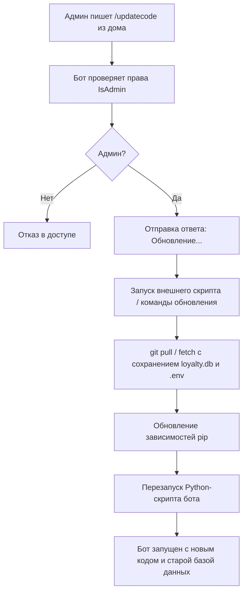

# План реализации автообновления бота для лаунж-бара

## Архитектура решения

Для реализации обновления бота прямо из дома с сохранением локальной базы данных (`loyalty.db`) и настроек (`.env`), мы используем следующий подход:

1. **Исключение файлов из Git**:
   - Файлы `loyalty.db` и `.env` должны быть добавлены в `.gitignore` на компьютере лаунж-бара (или изначально не отслеживаться через `git update-index --assume-unchanged loyalty.db .env`), чтобы команда `git pull` их не затирала и не перезаписывала.
   
2. **Скрипт обновления (`update.py` или `update.bat`)**:
   - Создаем скрипт, который выполняет:
     - `git fetch origin`
     - `git reset --hard origin/main` (или `git pull`), при этом файлы `loyalty.db` и `.env` остаются на месте, так как они игнорируются или защищены.
     - Установка новых зависимостей при необходимости (`pip install -r requirements.txt`).
     - Перезапуск процесса бота.

3. **Команда `/updatecode` в боте**:
   - В файле [`handlers/admin.py`](tg_bot_Galaktika/handlers/admin.py:1) добавляем обработчик команды `/updatecode`, доступный строго только администраторам (`IsAdmin`).
   - При вызове команды бот отправляет сообщение `🔄 Запуск обновления...`, запускает внешний скрипт обновления/перезапуска в отдельном процессе и завершает свою работу (`sys.exit(0)`), после чего операционная система (или фоновый менеджер процессов / `while true` цикл в скрипте запуска) поднимает обновленную версию.

---

## Диаграмма работы процесса обновления

---

## Шаги реализации

1. Настройка `.gitignore` на целевом компьютере и в репозитории для `loyalty.db` и `.env`.
2. Создание вспомогательного скрипта обновления (`update.sh` / `update.bat`).
3. Добавление команды `/updatecode` в [`handlers/admin.py`](tg_bot_Galaktika/handlers/admin.py:1).
4. Описание инструкции для первоначальной настройки Git на компьютере в лаунж-баре.
